# IT503PC: Machine Learning, Sem Exam Cheat Sheet

JNTUH UCEJ · JJR23 B.Tech IT (Autonomous) · III Year I Sem · L-T-P-C: 3-0-0-3

**Exam tip:** For a long answer, write the definition, then a diagram or steps, then an example, then pros and cons. For numericals (linear regression, Naive Bayes, entropy/information gain, k-Means, perceptron), show every step. Marks come from the steps.

## Syllabus Coverage Check

Every topic printed in your JJR23 syllabus is covered below, and each unit now also has worked examples.

| Unit | Syllabus topics | Covered in this doc |
| --- | --- | --- |
| I | Types of human learning, what is ML, types of ML, ML activities, applications | Yes: Basics, Types of ML |
| I | Types of data, exploring data, pre-processing, model selection and training, representation and interpretability, evaluation, performance enhancement | Yes: Model Preparation, Evaluation and Feature Engineering |
| I | Feature engineering, transformation, subset selection, PCA | Yes: Feature Engineering, PCA |
| II | Regression: simple, multiple, polynomial, logistic, MLE | Yes: Regression, plus a worked linear regression example |
| II | Classification: learning steps, Naive Bayes, kNN, decision tree, SVM, random forest | Yes: Classification, plus worked Naive Bayes and information gain examples |
| III | Unsupervised vs supervised, applications, clustering types, k-Means, k-Medoids, hierarchical, DBSCAN | Yes: Unit III, plus a worked k-Means example |
| IV | Biological and artificial neuron, activation functions, architectures, perceptron, learning process, backpropagation | Yes: Unit IV, plus worked perceptron and backprop updates |
| V | Deep learning, reinforcement learning overview, case studies (image, speech, spam, fraud) | Yes: Unit V |

---

## UNIT I: Introduction to Machine Learning

### Basics

- **Types of human learning:** learning under expert guidance, learning guided by knowledge gained from experts, and self-learning.
- **Machine learning (Tom Mitchell):** a program learns from experience **E** with respect to task **T** and performance measure **P** if its performance at T, measured by P, improves with E.
- **ML activities:** (1) prepare to learn: collect and clean data, (2) learn: build the model, (3) evaluate and predict, (4) improve performance.

### Types of ML

| Type | Data | Goal | Examples |
| --- | --- | --- | --- |
| Supervised | Labelled | Learn input → output mapping | Regression, classification (kNN, SVM) |
| Unsupervised | Unlabelled | Find hidden structure | Clustering, association rules, PCA |
| Semi-supervised | Few labels plus many unlabelled | Use both | Web page and image classification |
| Reinforcement | Reward signals from environment | Maximise cumulative reward | Game playing, robotics |

**Semi-supervised learning** uses a small amount of labelled data plus a large amount of unlabelled data. Typical methods are self-training (the model labels data itself and retrains) and co-training. It is useful when labelling is costly, e.g. web page classification, medical images and speech analysis.

**Applications:** spam filtering, recommendation systems, medical diagnosis, speech and image recognition, fraud detection, self-driving cars, stock prediction, sentiment analysis.

### Model Preparation, Evaluation and Feature Engineering

**Types of data**

- **Qualitative (categorical):** nominal (no order, e.g. colour) and ordinal (ordered, e.g. low/medium/high).
- **Quantitative (numeric):** interval (no true zero, e.g. temperature in °C) and ratio (true zero, e.g. height). Either can be discrete or continuous.

**Exploring the structure of data**

- Central tendency: mean, median, mode.
- Dispersion: range, variance, standard deviation, IQR (Q3 − Q1).
- Shape: skewness and kurtosis.
- Plots: histogram, box plot (shows outliers), scatter plot, bar chart.

**Data pre-processing**

- **Missing values:** delete the rows, or impute with mean, median, mode or a predicted value.
- **Outliers:** detect with z-score (|z| > 3) or the IQR rule (below Q1 − 1.5·IQR or above Q3 + 1.5·IQR). Remove, cap or transform them.
- **Normalisation (min-max):** x' = (x − min) / (max − min), which scales to \[0, 1\].
- **Standardisation (z-score):** x' = (x − μ) / σ.
- **Encoding categorical data:** label encoding, one-hot encoding.
- Also: removing duplicates and noise, discretisation (binning).

**Model selection and training (supervised)**

- **Hold-out:** split into train and test, commonly 70/30 or 80/20.
- **k-fold cross-validation:** split into k parts, train on k−1, test on 1, repeat k times and average. **LOOCV** is the extreme case where k = n.
- **Bootstrap sampling:** sample with replacement.
- **Underfitting:** model too simple, high bias, poor on both train and test.
- **Overfitting:** model memorises noise, high variance, good on train but poor on test.
- **Bias-variance trade-off:** a simpler model has high bias and low variance, a complex model has low bias and high variance. Aim for the balance.

**Stratified k-fold** is k-fold cross-validation in which every fold keeps the same class proportions as the full dataset. Use it for imbalanced data, because plain k-fold can give a fold with very few examples of the rare class.

**Model representation and interpretability:** a model should generalise well and be understandable (decision trees are very interpretable, neural networks are black boxes).

**Model types at a glance** (frequently asked as "differentiate between")

| Contrast | Description |
| --- | --- |
| Parametric vs non-parametric | Parametric models have a fixed number of parameters (linear and logistic regression, Naive Bayes). Non-parametric models grow with the data (kNN, decision trees). |
| Lazy vs eager learners | Lazy learners store the data and do the work at prediction time (kNN). Eager learners build a model during training (SVM, decision trees, ANN). |
| Generative vs discriminative | Generative models learn P(X, C) and use Bayes' rule (Naive Bayes). Discriminative models learn P(C given X) or the boundary directly (logistic regression, SVM). |
| Underfitting vs overfitting | Underfitting: too simple, high bias, poor on train and test. Overfitting: too complex, high variance, good on train and poor on test. |
| Classification vs regression | Classification predicts a discrete class label. Regression predicts a continuous value. |

**Evaluating classification models**

Confusion matrix terms: TP, TN, FP (Type I error), FN (Type II error).

- Accuracy = (TP + TN) / (TP + TN + FP + FN)
- Precision = TP / (TP + FP)
- Recall (sensitivity, TPR) = TP / (TP + FN)
- Specificity = TN / (TN + FP)
- F1 = 2·P·R / (P + R)
- **ROC curve:** TPR vs FPR at different thresholds. **AUC** is the area under it (closer to 1 is better).
- Also: Kappa statistic, log-loss.

**Evaluating regression models:** MAE = mean of |y − ŷ|, MSE = mean of (y − ŷ)², RMSE = √MSE, R² = 1 − SSres/SStot.

**Evaluating clustering:** silhouette coefficient, within-cluster SSE.

**Improving performance:** more data, feature engineering, regularisation (L1 Lasso, L2 Ridge), ensembles (bagging, boosting), hyper-parameter tuning (grid or random search), cross-validation.

**Bagging vs boosting** (ensemble methods)

| Point | Bagging | Boosting |
| --- | --- | --- |
| Idea | Train models independently on bootstrap samples and combine | Train models one after another, each fixing the previous one's errors |
| Reduces | Variance | Bias (and variance) |
| Weighting | All models vote equally | Later models focus on misclassified points |
| Example | Random forest | AdaBoost, Gradient Boosting, XGBoost |

**AdaBoost steps:** (1) give every sample equal weight, (2) train a weak learner, (3) compute its error ε and its weight α = ½ ln((1 − ε) / ε), (4) increase the weights of misclassified samples, (5) repeat, (6) the final prediction is a weighted vote of all learners.

**Stacking:** combine the predictions of several different models using a final meta-learner that is trained on those predictions.

### Feature Engineering

- **Definition:** creating and selecting the best input features to improve model performance.
- **Feature transformation:**
  - *Feature construction:* create new features from existing ones.
  - *Feature extraction:* create a smaller set of new features (e.g. PCA).
  - Also: scaling, log transform, binning, polynomial features.
- **Feature subset selection:** remove irrelevant and redundant features. This reduces overfitting, training time and the curse of dimensionality.
  - *Filter:* rank by statistics such as correlation or chi-square, independent of the model.
  - *Wrapper:* use the model to score subsets (forward selection, backward elimination, RFE). Accurate but costly.
  - *Embedded:* selection happens during training (Lasso, decision trees).

### Principal Component Analysis (PCA)

PCA is an unsupervised dimensionality reduction technique. It projects data onto orthogonal axes (principal components) that capture the maximum variance.

**Steps:**

1. Standardise the data.
2. Compute the covariance matrix.
3. Compute its eigenvalues and eigenvectors.
4. Sort eigenvectors by eigenvalue (descending).
5. Choose the top k components (explained variance, e.g. 95%).
6. Project the data: Z = X · W.

PC1 captures the most variance and the components are uncorrelated. Limitation: PCA is linear and the components are hard to interpret.

---

## UNIT II: Supervised Learning

**Supervised learning:** learn a function f: X → Y from labelled examples. The output is continuous for regression and discrete for classification.

### Regression

Regression predicts a continuous numerical value.

**Simple linear regression:** ŷ = β₀ + β₁x

- β₁ = Σ(x − x̄)(y − ȳ) / Σ(x − x̄)²
- β₀ = ȳ − β₁·x̄
- Least squares minimises the sum of squared errors.
- Gradient descent update: β ← β − α · ∂J/∂β, where α is the learning rate.
- R² near 1 means a good fit.
- Assumptions: linearity, independence, constant variance, normal errors.

**Gradient descent** (the optimiser behind regression and neural networks)

- Goal: minimise a cost function J(θ), such as the mean squared error.
- Update rule: θ ← θ − α · ∂J/∂θ, where α is the learning rate.
- For linear regression: β₀ ← β₀ − α · (1/n) Σ(ŷ − y) and β₁ ← β₁ − α · (1/n) Σ(ŷ − y)x.
- Steps: initialise parameters, compute the gradient, update, repeat until the cost stops falling.
- A very small α is slow. A very large α overshoots and may diverge.
- Types: batch (all data per step), stochastic or SGD (one sample per step), mini-batch (a small group per step).

**Multiple linear regression:** ŷ = β₀ + β₁x₁ + β₂x₂ + … + βₙxₙ

- Matrix form: **β = (XᵀX)⁻¹ Xᵀy** (normal equation).
- Watch for multicollinearity. Adjusted R² penalises useless features.

**Polynomial regression:** ŷ = β₀ + β₁x + β₂x² + … + βₙxⁿ

- Fits curves but is still linear in the coefficients.
- A high degree overfits.

**Logistic regression**

- Used for classification. It models the probability P(y=1|x) = σ(z) = 1 / (1 + e⁻ᶻ), where z = β₀ + β₁x₁ + …
- The sigmoid squashes the output to (0, 1). Odds = p/(1−p). Logit = ln(p/(1−p)) = z.
- Decision rule: predict class 1 if p ≥ 0.5.
- Loss: log-loss (cross-entropy) = −\[y·ln p + (1−y)·ln(1−p)\].
- Multi-class: one-vs-rest or softmax.

**Maximum Likelihood Estimation (MLE)**

- Choose the parameters θ that make the observed data most probable: L(theta) = ∏ P(xᵢ | θ).
- Take the log-likelihood (turns the product into a sum), differentiate, set to 0 and solve.
- Example: for a Gaussian, the MLE of the mean is the sample mean.
- Logistic regression parameters are found by MLE using gradient descent.

### Classification

**Classification model and learning steps:**

1. Collect and prepare data.
2. Split into train and test.
3. Choose the algorithm.
4. Train (learn the model).
5. Evaluate (confusion matrix and so on).
6. Tune and deploy.

**Naive Bayes classifier**

- Bayes' theorem: P(C|X) = P(X|C) · P(C) / P(X)
- *Naive* assumption: features are conditionally independent given the class, so P(X|C) = ∏ P(xᵢ|C).
- Predict the class with the highest posterior. P(X) is the same for all classes and can be ignored.
- **Laplace smoothing** avoids zero probabilities.
- Variants: Gaussian, Multinomial, Bernoulli.
- Pros: fast, works with little data, good for text. Cons: the independence assumption is unrealistic.

**k-Nearest Neighbour (kNN)**

- A lazy, instance-based learner. It stores data and classifies by majority vote of the k closest points.
- Distances: Euclidean √Σ(xᵢ−yᵢ)², Manhattan Σ|xᵢ−yᵢ|, Minkowski.
- Choosing k: a small k is noisy (overfits), a large k is too smooth. Use an odd k for 2 classes.
- Scale features first. Cons: slow at prediction, affected by irrelevant features and high dimensions.
- For regression, take the average of the neighbours.

**Decision tree**

- A tree structure where nodes test attributes, branches are outcomes and leaves are class labels.
- **Entropy:** H(S) = −Σ pᵢ log₂ pᵢ (0 means pure, 1 is the maximum for 2 classes).
- **Information gain:** IG(S, A) = H(S) − Σ (|Sᵥ|/|S|) · H(Sᵥ). Pick the attribute with the highest gain.
- **Gini index:** 1 − Σ pᵢ² (used by CART).
- Algorithms: **ID3** (information gain), **C4.5** (gain ratio, handles continuous data and missing values), **CART** (Gini, binary splits).
- **Pruning** (pre and post) reduces overfitting. Pros: easy to interpret. Cons: unstable, overfits.

**Support Vector Machine (SVM)**

- Finds the **maximum-margin hyperplane** w·x + b = 0 that separates the classes.
- Margin = 2/‖w‖. Maximising the margin means minimising ‖w‖²/2.
- **Support vectors** are the points closest to the hyperplane, and they alone define it.
- **Soft margin:** the parameter C trades margin width against misclassification (large C is a narrow margin, small C is a wide margin).
- **Kernel trick:** implicitly maps data to a higher dimension to separate non-linear data. Kernels: linear, polynomial, RBF (Gaussian), sigmoid.
- Pros: good in high dimensions. Cons: slow on large data, sensitive to the kernel and C.

**Random forest**

- An ensemble of many decision trees built by **bagging** (bootstrap samples) plus a **random subset of features** at each split.
- Classification by majority vote, regression by averaging.
- Reduces variance and overfitting. It gives feature importance and out-of-bag (OOB) error.
- Cons: less interpretable, heavier than a single tree.

### Worked Examples (Unit II)

**1. Simple linear regression.** Data: x = 1, 2, 3, 4, 5 and y = 2, 4, 5, 4, 5.

- Means: x̄ = 3, ȳ = 4.
- Σ(x − x̄)(y − ȳ) = (−2)(−2) + (−1)(0) + (0)(1) + (1)(0) + (2)(1) = 6.
- Σ(x − x̄)² = 4 + 1 + 0 + 1 + 4 = 10.
- β₁ = 6 / 10 = 0.6 and β₀ = 4 − 0.6 × 3 = 2.2.
- Model: ŷ = 2.2 + 0.6x. Prediction for x = 6: ŷ = 5.8.

**2. Entropy and information gain** (decision tree, the classic Play Tennis data: 14 samples, 9 Yes and 5 No).

- Entropy of the whole set: H(S) = −(9/14) log₂(9/14) − (5/14) log₂(5/14) = 0.940.
- Attribute Outlook: Sunny has 5 samples (2 Yes, 3 No) with H = 0.971. Overcast has 4 samples (all Yes) with H = 0. Rain has 5 samples (3 Yes, 2 No) with H = 0.971.
- Weighted entropy = (5/14)(0.971) + (4/14)(0) + (5/14)(0.971) = 0.694.
- Information gain = 0.940 − 0.694 = **0.246**. Compare this across attributes and split on the highest one. Repeat on each branch.

**3. Naive Bayes** (same Play Tennis data). Classify the new day X = (Outlook = Sunny, Wind = Strong).

- Priors: P(Yes) = 9/14 and P(No) = 5/14.
- Likelihoods: P(Sunny|Yes) = 2/9, P(Strong|Yes) = 3/9, P(Sunny|No) = 3/5, P(Strong|No) = 3/5.
- Score(Yes) = 9/14 × 2/9 × 3/9 = 0.0476.
- Score(No) = 5/14 × 3/5 × 3/5 = 0.1286.
- Normalised: P(Yes|X) = 0.27 and P(No|X) = 0.73. **Predict No.**

---

## UNIT III: Unsupervised Learning

**Unsupervised learning:** find patterns, structure and groupings in unlabelled data.

| Point | Supervised | Unsupervised |
| --- | --- | --- |
| Data | Labelled | Unlabelled |
| Goal | Predict output | Discover structure |
| Tasks | Classification, regression | Clustering, association, dimensionality reduction |
| Feedback | Direct (known answers) | None |
| Evaluation | Easy (accuracy and so on) | Harder (silhouette, domain knowledge) |

**Applications:** customer segmentation, document and news grouping, anomaly and fraud detection, image compression and segmentation, recommender systems, gene analysis, market basket analysis.

**Clustering and its types**

- Clustering groups objects so that similarity is high within a cluster and low between clusters.
- Types: **partitioning** (k-Means, k-Medoids), **hierarchical** (agglomerative, divisive), **density-based** (DBSCAN), grid-based, model-based (Gaussian mixtures).

**k-Means (partitioning)**

1. Choose k and initialise k centroids randomly.
2. Assign each point to its nearest centroid.
3. Recompute each centroid as the mean of its cluster.
4. Repeat steps 2 and 3 until the centroids stop changing.

- Objective: minimise SSE = Σ Σ ‖x − μᵢ‖².
- Choose k with the elbow method or silhouette score.
- Pros: simple and fast. Cons: k must be given, sensitive to initial centroids and outliers, finds only spherical clusters.

**k-Medoids (PAM)**

- Uses an actual data point (the medoid) as the cluster centre, instead of the mean.
- Minimises the sum of dissimilarities. It is **more robust to outliers and noise** than k-Means but computationally costlier.

**Hierarchical clustering**

- **Agglomerative (bottom-up):** start with each point as a cluster and merge the closest pair repeatedly.
- **Divisive (top-down):** start with one cluster and split repeatedly.
- Result is shown as a **dendrogram** (cut it at a level to get clusters).
- Linkage: single (minimum distance, chaining effect), complete (maximum distance), average, Ward (minimum variance increase).
- No need to specify k, but it is O(n²) or worse and merges cannot be undone.

**Density-based: DBSCAN**

- Parameters: **ε (eps)**, the neighbourhood radius, and **MinPts**, the minimum points in the neighbourhood.
- **Core point:** at least MinPts points within ε. **Border point:** within ε of a core point but not core itself. **Noise point:** neither.
- Clusters grow by density-reachability from core points.
- Pros: arbitrary-shaped clusters, detects noise, no k needed. Cons: sensitive to ε and MinPts, struggles with varying densities.

### Worked Example (Unit III): k-Means

Data (1-D): 2, 3, 4, 10, 11, 12. Take k = 2 with initial centroids C1 = 2 and C2 = 10.

- **Iteration 1:** points 2, 3, 4 are nearest to C1, and points 10, 11, 12 are nearest to C2. New centroids: C1 = (2 + 3 + 4) / 3 = 3 and C2 = (10 + 11 + 12) / 3 = 11.
- **Iteration 2:** assignments do not change (2, 3, 4 stay with 3; 10, 11, 12 stay with 11), so the centroids are unchanged. **Converged.**
- Final clusters: {2, 3, 4} and {10, 11, 12}. In an exam, write each distance calculation (|x − centroid|) in a small table.

### Worked Example (Unit III): Hierarchical Clustering

Agglomerative clustering with **single linkage** on 1-D points A = 1, B = 2, C = 6, D = 8, E = 15.

- Start with 5 clusters. The closest pair is A and B (distance 1), so merge them into {A, B}.
- Next closest is C and D (distance 2), so merge them into {C, D}.
- Single-link distance between {A, B} and {C, D} = min distance = |2 − 6| = 4, so merge them (distance 4).
- Last, E joins at distance |15 − 8| = 7.
- Dendrogram merge heights: 1, 2, 4, 7. Cut the dendrogram at height 5 to get 2 clusters: {A, B, C, D} and {E}.

---

## UNIT IV: Artificial Neural Networks

**Biological neuron:** dendrites (receive signals), cell body or soma (processes), axon (transmits), synapse (junction, with strength like a weight).

**Artificial neuron:** inputs x₁…xₙ with weights w₁…wₙ, a bias b, a summation and an activation function.

- Output **y = f(Σ wᵢxᵢ + b)**.

**Activation functions**

| Function | Formula | Range | Note |
| --- | --- | --- | --- |
| Step | 1 if z ≥ 0 else 0 | {0, 1} | Perceptron |
| Sigmoid | 1/(1+e⁻ᶻ) | (0, 1) | Vanishing gradient, derivative σ(1−σ) |
| Tanh | (eᶻ−e⁻ᶻ)/(eᶻ+e⁻ᶻ) | (−1, 1) | Zero-centred |
| ReLU | max(0, z) | \[0, ∞) | Fast, the default in hidden layers |
| Leaky ReLU | max(0.01z, z) | (−∞, ∞) | Avoids dead neurons |
| Softmax | eᶻⁱ/Σeᶻʲ | (0, 1), sums to 1 | Multi-class output |

**Architectures**

- **Single-layer feedforward:** inputs connect directly to outputs.
- **Multi-layer feedforward (MLP):** input, hidden and output layers, with information flowing one way.
- **Recurrent (feedback):** loops allow memory of previous inputs.

**Perceptron**

- A single neuron with a step activation, a binary linear classifier.
- **Learning rule:** wᵢ ← wᵢ + η (t − y) xᵢ, where η is the learning rate, t the target and y the output.
- Converges only for linearly separable data. It **cannot solve XOR**, which motivates multi-layer networks.

**Learning process in ANN**

1. Initialise weights randomly.
2. **Forward pass:** compute the outputs.
3. Compute the **loss** (MSE or cross-entropy).
4. **Backward pass:** compute gradients.
5. **Update weights** by gradient descent.
6. Repeat over epochs.

Key terms: epoch, batch size, learning rate, loss function.

**Backpropagation**

- Propagates the error backward from output to input using the **chain rule** to compute ∂E/∂w for each weight.
- Weight update: **Δw = η · δ · input**.
- Output neuron (sigmoid, squared error): δₖ = (tₖ − oₖ) · oₖ(1 − oₖ).
- Hidden neuron: δⱼ = oⱼ(1 − oⱼ) · Σₖ δₖ wⱼₖ.
- Issues: vanishing gradients, local minima, overfitting. Remedies: ReLU, momentum, regularisation, dropout.

### Worked Examples (Unit IV)

**1. Perceptron update.** Learning the AND gate with w₁ = w₂ = 0, b = 0, η = 1 and a step activation (output 1 if the sum is above 0, else 0).

- Sample (1, 1) with target t = 1. Sum = 0, so output y = 0 and the error is t − y = 1.
- w₁ = 0 + 1 × 1 × 1 = 1, w₂ = 0 + 1 × 1 × 1 = 1, b = 0 + 1 × 1 = 1.
- Repeat over all four samples until no errors remain.

**3. Full perceptron training: AND gate.** Start with w₁ = w₂ = 0, b = 0, η = 1. Output is 1 if w₁x₁ + w₂x₂ + b > 0, else 0. Update only when the output is wrong, using w ← w + η(t − y)x and b ← b + η(t − y). Sample order: (0,0), (0,1), (1,0), (1,1).

| Epoch | Weights after the epoch (w₁, w₂, b) |
| --- | --- |
| 1 | (1, 1, 1) |
| 2 | (2, 1, 0) |
| 3 | (2, 1, −1) |
| 4 | (2, 2, −1) |
| 5 | (2, 1, −2) |
| 6 | (2, 1, −2), no errors, so training stops |

Check the final model: (0,0) gives −2, (0,1) gives −1, (1,0) gives 0 and (1,1) gives 1. So the outputs are 0, 0, 0, 1, which is the AND truth table.

**2. Backpropagation weight update** (sigmoid output neuron). Output o = 0.8, target t = 1, hidden output h = 0.5, weight w = 0.4, learning rate η = 0.5.

- δ = (t − o) × o × (1 − o) = 0.2 × 0.8 × 0.2 = 0.032.
- Δw = η × δ × h = 0.5 × 0.032 × 0.5 = 0.008.
- New weight: w = 0.4 + 0.008 = **0.408**.

---

## UNIT V: Advanced Topics in Machine Learning

**Deep learning**

- Neural networks with many hidden layers that learn hierarchical features automatically, which removes manual feature engineering.
- It became practical thanks to big data, GPUs and better algorithms.
- **CNN:** convolution layers, pooling and fully connected layers. Used for images and video.
- **RNN / LSTM:** sequence models for text, speech and time series.
- Others: autoencoders, GANs, Transformers.

**Machine learning vs deep learning**

| Point | Machine learning | Deep learning |
| --- | --- | --- |
| Data needed | Works with small to medium data | Needs very large data |
| Features | Hand-crafted by the engineer | Learned automatically |
| Hardware | CPU is usually enough | GPU is usually needed |
| Interpretability | Often easier (trees, regression) | Black box |
| Examples | SVM, random forest, kNN | CNN, RNN, Transformers |

**Reinforcement learning (overview)**

- An **agent** interacts with an **environment**, observes a **state**, takes an **action** and receives a **reward**. It learns a **policy** that maximises cumulative reward.
- Concepts: reward, policy, value function, discount factor γ, **exploration vs exploitation**, Markov Decision Process (MDP).
- **Q-learning:** Q(s,a) ← Q(s,a) + α \[ r + γ · maxₐ' Q(s',a') − Q(s,a) \]
- Applications: games (chess, Go), robotics, self-driving, resource allocation.

**Markov Decision Process (MDP)** is the formal model of reinforcement learning.

- It is a tuple (S, A, P, R, γ): states, actions, transition probabilities P(s' | s, a), rewards R(s, a) and a discount factor γ between 0 and 1.
- **Markov property:** the next state depends only on the current state and action, not on the earlier history.
- Goal: find a policy π that maximises the expected discounted return.
- Bellman equation: V(s) = max over a of \[ R(s, a) + γ Σ P(s' | s, a) V(s') \].
- Solved by value iteration or policy iteration when the model is known, and by Q-learning when it is not.

**Case studies of ML applications**

- **Image recognition:** CNNs learn edges, then shapes, then objects. Applications: face recognition, medical imaging, object detection. Steps: image pre-processing, feature extraction, classification.
- **Speech recognition:** audio to features (MFCC), then acoustic model (HMM or RNN/LSTM), then language model, then text. Applications: voice assistants, transcription.
- **Email spam filtering:** text is cleaned (tokenisation, stop-word removal), converted to bag-of-words or TF-IDF, then classified with Naive Bayes, SVM or others. Precision is important because a real mail marked as spam is costly.
- **Online fraud detection:** the data is highly imbalanced and fraud is rare. Methods: anomaly detection, classification (random forest, neural networks), resampling (SMOTE). Prefer recall, precision and F1 over plain accuracy. Needs real-time prediction.
- Others: recommender systems, medical diagnosis, stock prediction.

---

## Quick Comparison Table

| Algorithm | Type | Key idea | Weakness |
| --- | --- | --- | --- |
| Linear regression | Supervised, regression | Best-fit line, least squares | Only linear relations |
| Logistic regression | Supervised, classification | Sigmoid probability | Linear boundary |
| Naive Bayes | Supervised | Bayes + independence | Independence assumption |
| kNN | Supervised | Vote of k nearest | Slow prediction |
| Decision tree | Supervised | Split by gain or Gini | Overfits |
| SVM | Supervised | Maximum margin + kernels | Slow on big data |
| Random forest | Supervised, ensemble | Many trees + voting | Less interpretable |
| k-Means | Unsupervised | Centroid assignment | Needs k, outliers |
| k-Medoids | Unsupervised | Actual-point centres | Costly |
| Hierarchical | Unsupervised | Dendrogram | Slow, irreversible |
| DBSCAN | Unsupervised | Density regions | Needs ε and MinPts |
| ANN / Perceptron | Supervised | Weighted sum + activation | Needs lots of data |

## Formula Quick-Fire

- Accuracy = (TP + TN) / total
- Precision = TP / (TP + FP)
- Recall = TP / (TP + FN)
- F1 = 2PR / (P + R)
- Min-max: (x − min) / (max − min)
- z-score: (x − μ) / σ
- Euclidean: √Σ(xᵢ − yᵢ)²
- Entropy: −Σ p log₂ p
- Gini: 1 − Σ p²
- Bayes: P(C|X) = P(X|C) P(C) / P(X)
- Sigmoid: 1 / (1 + e⁻ᶻ)
- Perceptron: w ← w + η (t − y) x
- Normal equation: β = (XᵀX)⁻¹ Xᵀy

## Last-Minute Checklist

- Draw the **ANN architecture, dendrogram, SVM margin and decision tree** diagrams. They score easy marks.
- Practise one numerical each: simple linear regression, entropy and information gain, k-Means (2 iterations), Naive Bayes, perceptron update.
- Know the difference tables: supervised vs unsupervised, k-Means vs k-Medoids, overfitting vs underfitting, bagging vs boosting.
- For case-study questions, cover the data, features, algorithm and metric used.

## Likely Exam Questions

| Marks | Question types to prepare |
| --- | --- |
| 2 to 3 | Define machine learning (Mitchell). Supervised vs unsupervised. What is overfitting? Precision and recall. What is a lazy learner? Laplace smoothing. What is the kernel trick? What is a support vector? Why can a perceptron not solve XOR? Core, border and noise points. What is a medoid? What is a dendrogram? |
| 5 | Types of ML with examples. Data pre-processing steps. Evaluation metrics from a confusion matrix. Filter, wrapper and embedded feature selection. Logistic regression and the sigmoid. Naive Bayes. kNN. SVM. Random forest. k-Means vs k-Medoids. DBSCAN. Activation functions. Perceptron learning rule. Spam filtering case study. |
| 10 | ML activities plus model preparation and evaluation. PCA with steps. Decision tree with ID3 (entropy and gain). Linear regression numerical. k-Means numerical. Hierarchical clustering with a dendrogram. ANN architecture with backpropagation. Deep learning and reinforcement learning overview. Case studies of ML applications (image, speech, spam, fraud). |

## Important Questions Found Online

These repeat across recent JNTUH-pattern ML papers: the [Anurag R22 model paper (June 2025)](https://anurag.ac.in/wp-content/uploads/2025/03/R22-III-II-ML-CSE-IT-Model-QP.pdf), the [MRCET R22 supplementary paper (June 2025)](https://mrcet.com/pdf/Question%20Banks/2025/3-1/R22/ML.pdf) and older [R18 papers from NRCM](https://nrcmec.org/pdf/Course-Content/IT/NR23/III-I/ML/ML_Previous_QP.pdf). I could not find a paper for your exact JJR23 syllabus, so treat this as a strong guide, not a guarantee.

| Unit | Questions that appeared | Priority |
| --- | --- | --- |
| I | Different learning methods (types of ML). PCA as dimensionality reduction, with an example. Feature selection methods compared, including embedded. Min-max normalisation. Confusion matrix, accuracy metrics and ROC curve. Bias-variance trade-off. K-fold vs stratified K-fold. Underfitting and overfitting. Machine learning vs deep learning. | Very high |
| II | Structure and working of a decision tree with an example, and information gain. SVM and kernel SVM, and what a support vector is. Naive Bayes numerical. kNN numerical. Gradient descent. Random forest. Boosting. | Very high |
| III | K-Means numerical with given centroids. | High |
| IV | Perceptron and its training with an example. Backpropagation. What an ANN is. Decision tree vs ANN interpretability. | High |
| V | Markov decision process and the goal of reinforcement learning. Ensemble techniques. Environment in reinforcement learning. | Medium |
| Short | Define ML. Applications of ML. What is a perceptron? What is overfitting? What is kernel SVM? Which algorithm is used for clustering? | Very high |

**Appeared in those papers but outside your printed syllabus (low priority):** Find-S algorithm, Linear Discriminant Analysis, Expectation Maximization, k-modes clustering, genetic algorithms, PROLOG-EBG, temporal difference learning. Skim them only if you have time left.

### Solved Numericals from Those Papers

**1. Naive Bayes** (MRCET paper). Data has 8 rows: species M = rows 1 to 4, species H = rows 5 to 8. Classify X = (Color = Green, Legs = 2, Height = Tall, Smelly = No).

- P(M) = P(H) = 4/8 = 0.5.
- Class M: P(Green|M) = 2/4, P(Legs 2|M) = 1/4, P(Tall|M) = 1/4, P(Smelly No|M) = 1/4. Score = 0.5 × 0.5 × 0.25 × 0.25 × 0.25 = 0.0039.
- Class H: P(Green|H) = 1/4, P(Legs 2|H) = 4/4, P(Tall|H) = 2/4, P(Smelly No|H) = 3/4. Score = 0.5 × 0.25 × 1 × 0.5 × 0.75 = 0.0469.
- **Predict species H.**

**2. kNN, K = 3** (MRCET paper). Query X = (Maths 6, CS 8). Euclidean distances: (4,3) Fail = 5.39, (6,7) Pass = 1.00, (7,8) Pass = 1.00, (5,5) Fail = 3.16, (8,8) Pass = 2.00.

- The 3 nearest are (6,7), (7,8) and (8,8), all Pass. **Predict Pass.**

**3. K-Means** (MRCET paper). Data {2, 4, 10, 12, 3, 20, 30, 11, 25}, initial centroids m1 = 2 and m2 = 4.

- Iteration 1: m1 gets {2, 3} (the tie for 3 goes to m1), m2 gets the rest. New centroids: 2.5 and 16.
- Iteration 2: m1 = {2, 3, 4}, m2 = {10, 11, 12, 20, 25, 30}. Centroids: 3 and 18.
- Iteration 3: 10 moves to m1. Centroids: 4.75 and 19.6.
- Iteration 4: 11 and 12 move to m1. Centroids: 7 and 25.
- Iteration 5: no change, so it has converged. **Final clusters: {2, 3, 4, 10, 11, 12} and {20, 25, 30}.**

## Memory Tricks

- **Precision** is about what the model *predicted* as positive. **Recall** is about what was *really* positive.
- **Bias** means too simple (underfits). **Variance** means too jumpy (overfits).
- **Bagging** means parallel models that cut variance. **Boosting** means sequential models that cut bias.
- **DBSCAN points:** core has MinPts neighbours, border sits near a core, noise has neither.
- **ANN training loop:** forward pass, loss, backward pass, update weights.
- **Supervised** has a teacher (labels). **Unsupervised** has no teacher (finds groups). **Reinforcement** has a critic (reward).

**Prescribed books:** Saikat Dutt, S. Chandramouli, Das (Pearson); Ethem Alpaydin, *Introduction to Machine Learning* (3e, MIT Press, 2016); Anuradha Srinivasaraghavan and Vincy Joseph (Wiley); Tom M. Mitchell, *Machine Learning* (McGraw Hill, 2013). **Reference:** Peter Flach, *Machine Learning: The Art and Science of Algorithms that Make Sense of Data* (Cambridge, 2012); Jason Bell, *Machine Learning: Hands-On for Developers and Technical Professionals* (Wiley, 2014).
## Quick Reference Diagrams

### Types of ML

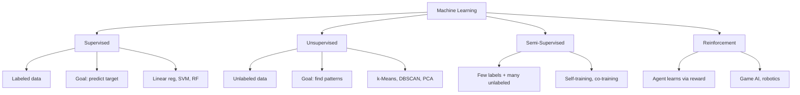

### ML Pipeline

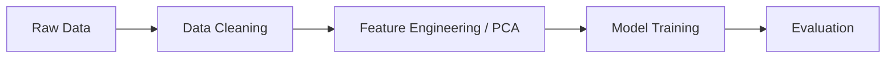

### PCA Steps

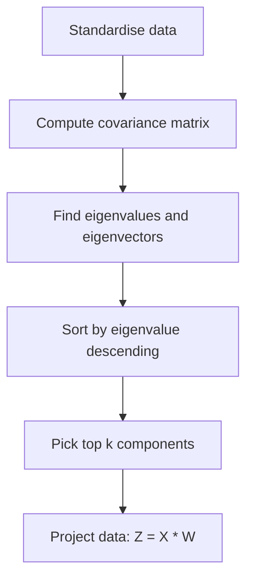

### Feature Subset Selection

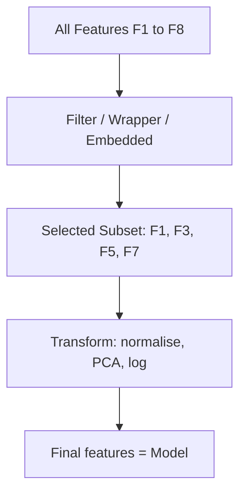

### Pre-processing Pipeline

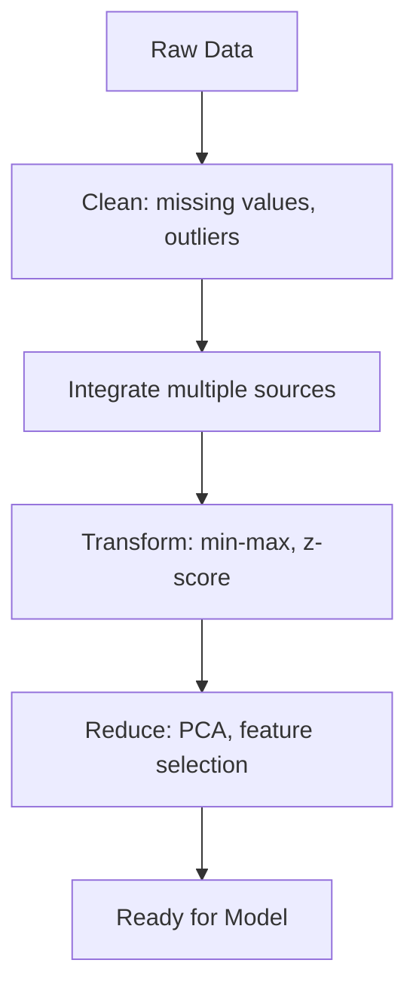

### Confusion Matrix

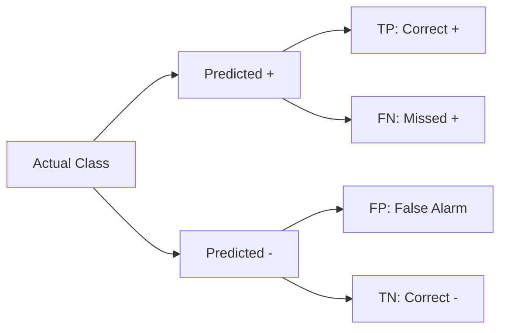

| | Predicted + | Predicted − |
|---|---|---|
| **Actual +** | TP | FN |
| **Actual −** | FP | TN |

---


### Regression Flow

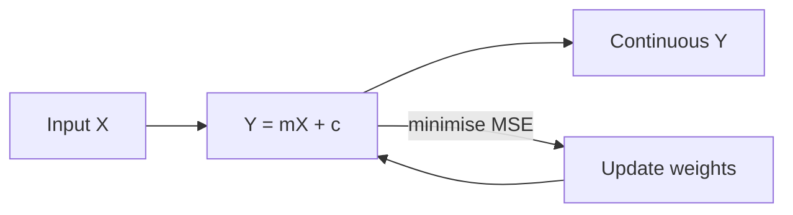

### Logistic Regression

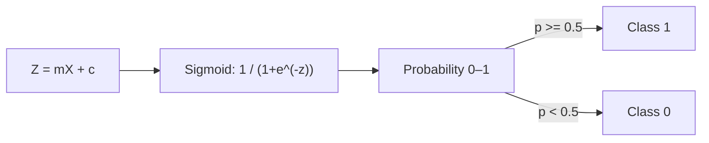

### Naive Bayes

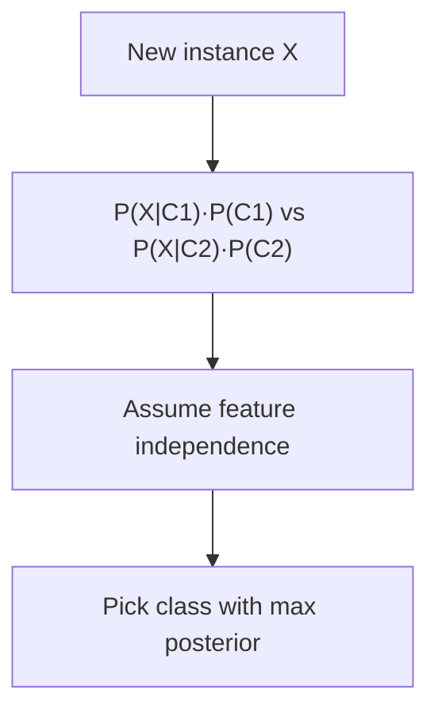

### kNN

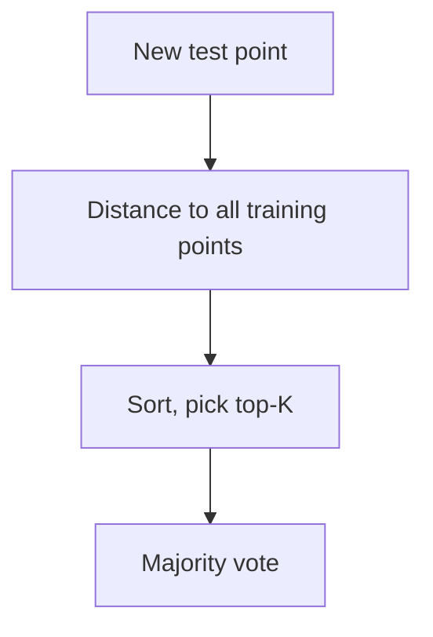

### Decision Tree

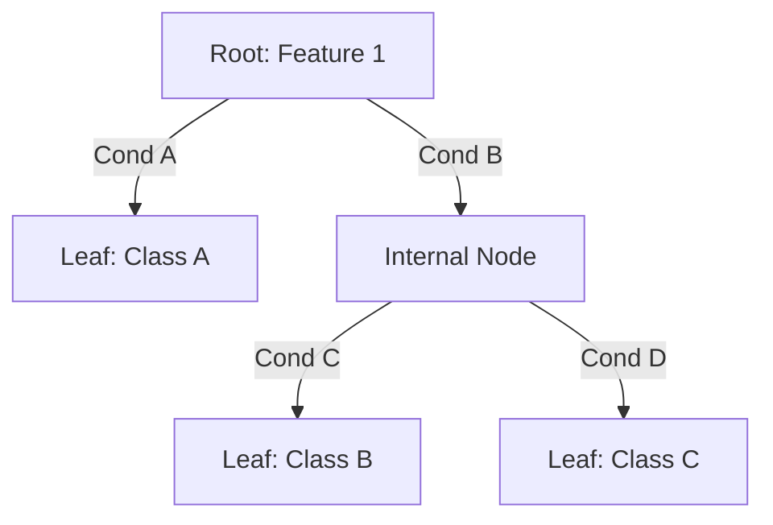

### SVM

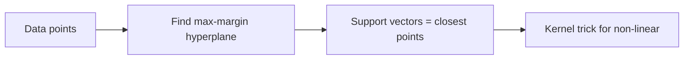

### Random Forest

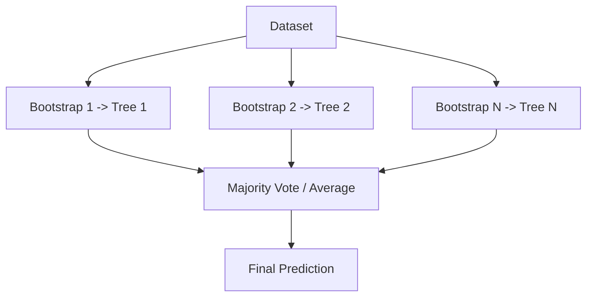

### MLE Steps

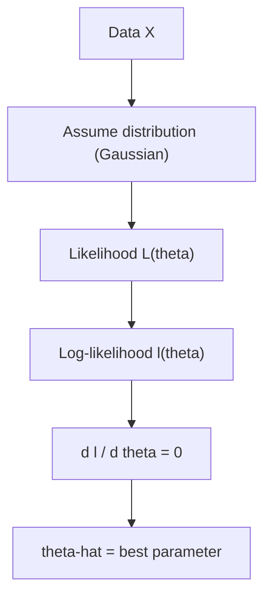

---


### k-Means Loop

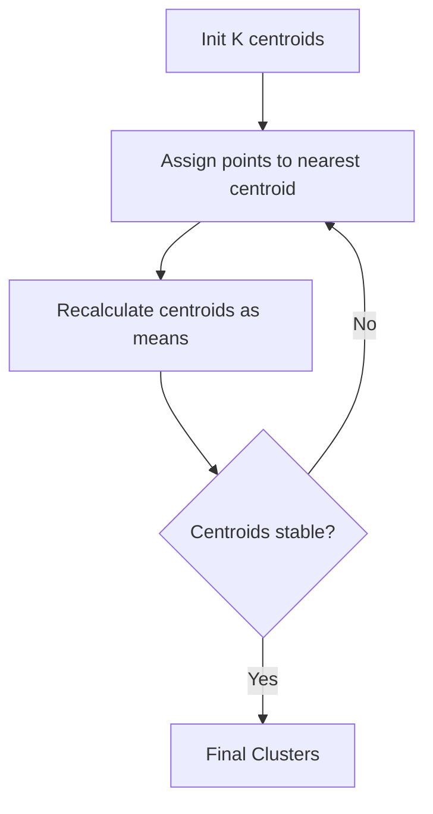

### DBSCAN

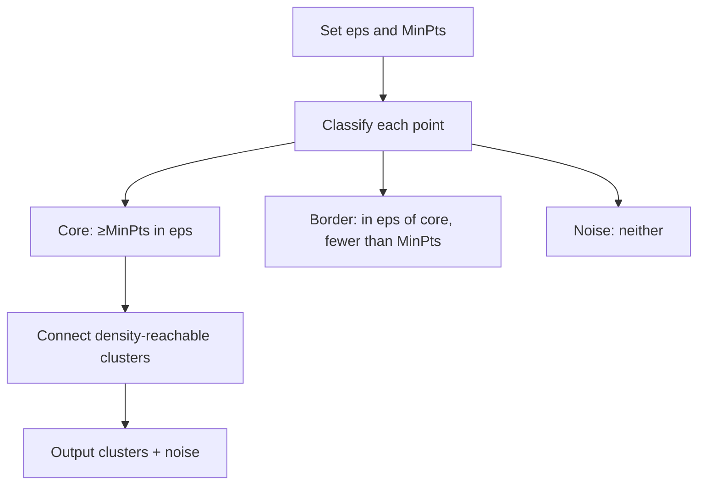

### Hierarchical / Dendrogram

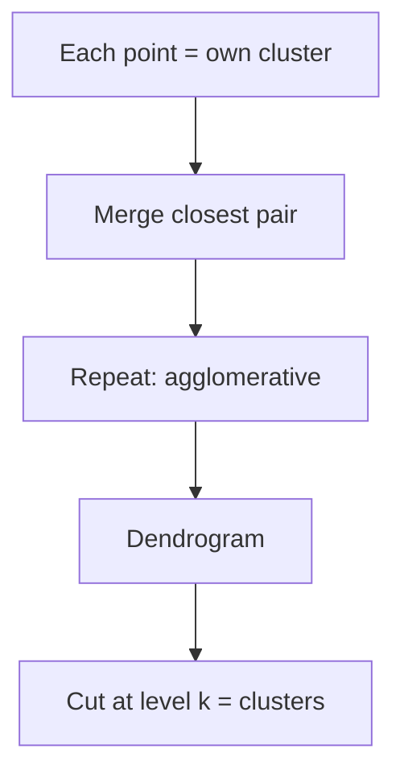

### k-Means vs k-Medoids

| | k-Means | k-Medoids |
|---|---|---|
| Centre | Mean of points | Actual data point |
| Outlier sensitivity | High | Low |
| Cost | Fast | O(kn) per iter |

---


### Perceptron

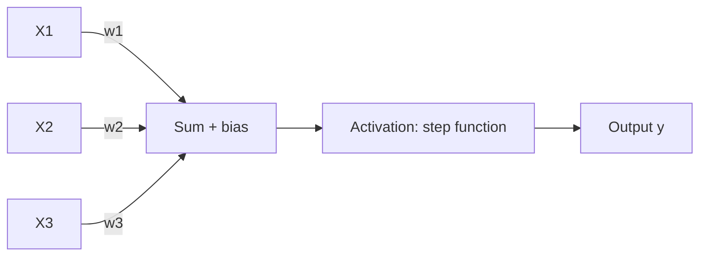

### Bi vs Artificial Neuron

| Bio Neuron | Artificial Neuron |
|---|---|
| Dendrites | Inputs x₁…xₙ |
| Synapse | Weights w₁…wₙ |
| Cell body | Sum + bias |
| Axon | Activation function |
| Output | y |

### ANN Forward & Backward Pass

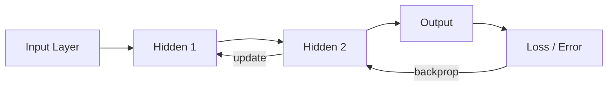

### Activation Functions

| Function | Formula | Range |
|---|---|---|
| Sigmoid | 1/(1+e⁻ˣ) | (0,1) |
| Tanh | (eˣ−e⁻ˣ)/(eˣ+e⁻ˣ) | (−1,1) |
| ReLU | max(0,x) | [0,∞) |
| Softmax | e^zᵢ/Σe^zⱼ | (0,1), sums to 1 |

### Backprop Chain Rule

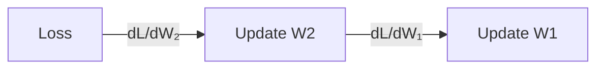

### Learning Process (Epoch Loop)

```mermaid
flowchart TD
    A["Forward pass"] --> B["Compute loss"]
    B --> C["Backward pass: gradients"]
    C --> D["Update weights"]
    D -->|next epoch| A
```

---


### Reinforcement Learning

```mermaid
flowchart LR
    AGENT["Agent"] -->|"Action A"| ENV["Environment"]
    ENV -->|State S + Reward R| AGENT
    AGENT["Agent"] -->|"Update policy"| AGENT["Agent"]
```

### CNN Pipeline

```mermaid
flowchart TD
    A["Input Image"] --> B["Conv + ReLU: edges"]
    B --> C["Pooling: reduce size"]
    C --> D["Repeat conv+pool"]
    D --> E["Flatten to 1D"]
    E --> F["Dense layers"]
    F --> G["Softmax = class prob"]
```

### Case Study Pipelines

```mermaid
flowchart LR
    subgraph Spam
        S1["Email text"] --> S2["Preprocess + TF-IDF"]
        S2 --> S3["Naive Bayes"]
        S3 --> S4["Spam or Not Spam"]
    end
```

```mermaid
flowchart LR
    subgraph Speech
        A1["Audio"] --> A2["MFCC features"]
        A2 --> A3["Acoustic model HMM or RNN"]
        A3 --> A4["Language model"]
        A4 --> A5["Transcript"]
    end
```

```mermaid
flowchart LR
    subgraph Fraud
        F1["Transaction"] --> F2["Feature flags: time, amount, location"]
        F2 --> F3["Anomaly or Classification model"]
        F3 --> F4["Score above threshold = Block"]
    end
```

### ML vs Deep Learning

| | Traditional ML | Deep Learning |
|---|---|---|
| Features | Hand-crafted | Learned automatically |
| Data | Small/medium | Very large |
| Hardware | CPU | GPU |
| Interpretability | High | Low |

---

## Formulas Quick-Reference

| Formula | |
|---|---|
| Accuracy | (TP+TN)/(total) |
| Precision | TP/(TP+FP) |
| Recall | TP/(TP+FN) |
| F1 | 2PR/(P+R) |
| Euclidean | √Σ(xᵢ−yᵢ)² |
| Manhattan | Σ\|xᵢ−yᵢ\| |
| Entropy | −Σp·log₂p |
| Gini | 1−Σp² |
| Bayes | P(C\|X) = P(X\|C)P(C)/P(X) |
| Sigmoid | 1/(1+e⁻ᶻ) |
| Perceptron update | w ← w + η(t−y)x |
| Normal eqn | β = (XᵀX)⁻¹Xᵀy |
| Q-learning | Q(s,a)+α[r+γ·maxQ(s',a')−Q(s,a)] |
